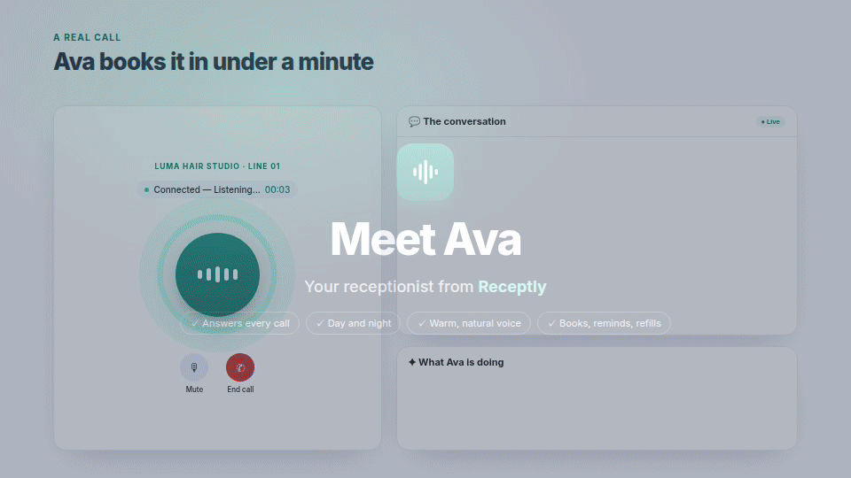
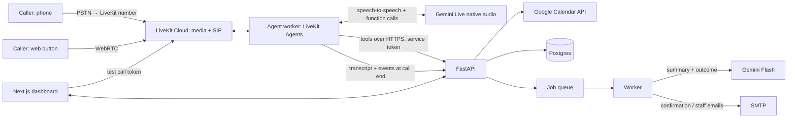

# AI Voice Receptionist



**Never miss a call: an AI receptionist for salons, clinics and other appointment businesses
that answers by phone or website, books, moves and cancels appointments in Google Calendar,
and hands off to a human when needed.**

[Live demo](#live-demo) · [Showcase video (82 s, with voiceover)](docs/images/showcase.mp4) · [Architecture](docs/architecture.md)

Demo business: **Luma Hair Studio** (fictional), receptionist persona **Ava**.

## What it does

- **Answers calls** by phone (LiveKit SIP number) or from a "Talk to the receptionist" button on
  the website (WebRTC). Natural speech-to-speech with Gemini Live; callers can interrupt
  mid-sentence. Greets with the business name and a recording notice.
- **Books, reschedules and cancels** in Google Calendar using real free/busy, opening hours,
  holidays, service durations and buffers. Reads details back and asks for a clear "yes".
- **Answers FAQs** (parking, prices, policies) from the business's knowledge base.
- **Takes messages and hands off**: urgent alert + email to staff, or a SIP transfer to the
  salon's phone when `TRANSFER_ENABLED=true`.
- **Knows who works when**: each person's own hours, time off, weekly breaks and holidays;
  Ava only offers times when that person is working and free.
- **Texts customers** (Twilio): confirmations, a reminder before the appointment with
  "reply C to cancel", and waitlist offers.
- **Waitlist**: when a day is full Ava offers the waitlist; a cancellation is offered to the
  first matching person, held for 30 minutes, then passed on.
- **Shows its value**: the overview reports the value of bookings Ava made and the calls she
  answered while the business was closed.
- **Records every call**: transcript, summary, outcome, tool calls and response latency in the
  dashboard, plus a confirmation email to the caller.
- **Dashboard** (from the Stitch design): overview KPIs, calls, call detail, appointments,
  waitlist, messages/callbacks, team & schedules, knowledge base with "unanswered questions",
  settings with a "Connect Google Calendar" button, a setup wizard for new businesses, and a
  test-call button. Roles: `admin` and `staff`.

## Results

From `make eval` (tools mode, deterministic, runs in CI on every push):

| Metric | Result |
|---|---|
| Scenarios | 30 (book, reschedule, cancel, FAQ, fully booked, out of hours, changes mind, human handoff, off-topic/abusive, ambiguous date, wrong caller) |
| Task success rate | **100%** |
| Correct-tool-call rate | **100%** |
| Invented-slot rate | **0%** (2 deliberate attempts refused) |
| Double bookings | **0** (incl. 20 simultaneous attempts on one slot → 1 booking) |
| Handoff accuracy | **100%** |
| Guardrail pass rate | **100%** (wrong caller can't cancel or see a booking) |

Tools mode replays each scenario's ideal tool sequence plus deliberate bad moves against the
real API and Postgres, so it proves the guarantees the server enforces. Conversation quality
(the model choosing the right tools from free speech) is measured by **LLM mode**
(`make eval MODE=llm`: Gemini caller + Gemini judge, needs `GEMINI_API_KEY`) and voice latency
by 10 scripted web calls; those results are written to `eval/results_llm.md` when run with keys.
Full table: [eval/results.md](eval/results.md).

## Architecture



The agent is thin and replaceable; the API owns every business rule. Details, call flow,
booking guarantees, retention and backups: [docs/architecture.md](docs/architecture.md).

## Stack & why

| Component | Choice | Why |
|---|---|---|
| Voice | LiveKit Agents (Apache 2.0) + LiveKit Cloud | WebRTC + SIP, barge-in, self-hostable, free Build plan |
| Voice model | Gemini Live native audio | One speech-to-speech model: low delay, natural voice, tools |
| API | FastAPI + Pydantic v2 | Typed validation, OpenAPI docs |
| Jobs | Postgres queue (`SKIP LOCKED`) | Durable retries without Redis |
| Data | PostgreSQL 16 + Alembic | One database; versioned migrations |
| Calendar | Google Calendar (service account) | What small businesses use; free |
| Email | SMTP outbox (idempotent) | Free, provider-neutral |
| Text LLM | Gemini Flash behind `app/llm.py` | Summaries + eval judge; one file to swap provider |
| Dashboard | Next.js 16 + shadcn/ui + Tailwind 4 | Same front end across projects; Stitch "Clinical Calm" design |
| Tests | pytest (real Postgres), Playwright, 30-scenario eval | Unit, integration, e2e and behaviour |
| Prod profile | Azure Container Apps, PG Flexible Server, Key Vault, App Insights (Bicep) | What clients run; validated in CI |

Every choice and the trade-offs: [docs/DECISIONS.md](docs/DECISIONS.md).

## Quick start

```bash
cp .env.example .env            # optional: works without keys (local calendar, no emails)
docker compose up --build       # Postgres, migrations + demo data, API, worker, dashboard
docker compose exec api python -m app.cli create-admin --email you@example.com
```

Open http://localhost:3010 (landing) and http://localhost:3010/dashboard. API docs:
http://localhost:8010/docs. For live voice, add the LiveKit and Gemini keys to `.env` and run
the agent: `make agent-dev`.

No uv/Node locally? Every `make` target runs in the toolbox: `docker compose run --rm dev make check`.

## Configuration

All variables are listed with comments and links in [.env.example](.env.example): LiveKit,
Gemini, Google Calendar (service account or the "Connect" button's OAuth client), Twilio
texts, SMTP, agent service token, call limits, retention, demo mode, CORS. Secrets only ever
come from the environment (Key Vault in production).

- **Texts:** set `TWILIO_*` and point the Twilio number's incoming-message webhook at
  `{PUBLIC_URL}/api/sms/inbound`. Without it, texts are listed but not sent.
- **Connect Google Calendar:** create an OAuth "Web" client, add
  `{PUBLIC_URL}/api/integrations/google/callback` as a redirect URI, set
  `GOOGLE_OAUTH_CLIENT_ID/SECRET`; owners then click Settings → Integrations → Connect.

## Evaluation

```bash
make db && make eval                 # tools mode: deterministic, no key needed
GEMINI_API_KEY=... make eval MODE=llm  # conversation quality with a Gemini caller + judge
```

Scenarios live in `eval/scenarios/*.yaml` (persona, goal, expected tools, expected final
state, scripted tool sequence). Results are committed in `eval/results.md` and `.json`. The LLM
runner throttles to the free tier, retries with backoff and caches judge calls.

## Costs

**Development: $0** — LiveKit Build plan (1,000 agent minutes, one free US number with 50
inbound minutes, no card), Gemini free tier, Google Calendar API, Gmail SMTP, Vercel Hobby /
Render free / Neon free. Free-tier limits: Gemini Live concurrency and rate limits, 5 concurrent
LiveKit sessions and cold starts after idle, Render sleeps when idle (the UI shows "waking up
the demo server"). Build fits a demo (about 330 three-minute calls, ~16 of them by phone), not
real customers.

**Production, estimated** (list prices, 3-minute average call, every call by phone as the worst
case; LiveKit prices from [livekit.com/pricing](https://livekit.com/pricing), checked
2026-11-23):

| Item | 500 calls/month | 2,000 calls/month |
|---|---|---|
| Gemini Live paid audio (~$0.03/min incl. context) | ~$45 | ~$180 |
| LiveKit Cloud Ship plan (base fee, includes 5,000 agent minutes and 20 concurrent calls) | $50 | $50 |
| LiveKit agent minutes over 5,000 ($0.01/min) | $0 | ~$10 |
| Phone: LiveKit US number (1 free) + inbound $0.01/min after 100 free minutes | ~$14 | ~$59 |
| Azure (Container Apps ×3, PG Flexible B1ms, Key Vault, App Insights, Blob) | ~$110 | ~$140 |
| **Total** | **~$220 (~$0.44/call)** | **~$440 (~$0.22/call)** |

Web calls use no phone minutes, so a mix of web and phone calls costs less. Bringing your own
Twilio/Telnyx SIP trunk instead of a LiveKit number costs $0.004/min on LiveKit after 5,000 free
minutes, plus the trunk provider's own rate.

Per-call model cost is measured per call (tokens → estimated USD) and shown in the call record.

## Production deployment

- **Azure profile** in [deploy/azure/main.bicep](deploy/azure/main.bicep): Container Apps for the
  API (1–5 replicas on HTTP load), the job worker and the voice agent; Azure Database for
  PostgreSQL Flexible Server (14-day PITR backups); Blob Storage; Key Vault read through a
  user-assigned managed identity (no secrets in app settings); Application Insights collecting
  the JSON logs. CI builds and lints the Bicep; the deploy workflow runs on a release tag and is
  disabled until `AZURE_DEPLOY_ENABLED=true`.
- **Telephony**: LiveKit Cloud paid plan or self-hosted LiveKit, with a Twilio/Telnyx SIP trunk
  for a local number in the client's country.
- **Scaling**: stateless API; workers scale independently thanks to `SKIP LOCKED`; voice
  capacity scales with agent replicas and the LiveKit/Gemini plan.
- **Security summary**: Argon2id passwords, httpOnly/Secure/SameSite session cookies, CSRF on
  every state-changing request, login and public-endpoint rate limits, admin/staff roles,
  service token for the agent, 10-minute room-limited LiveKit tokens, strict Pydantic
  validation, CSP and security headers, CORS allow-list, non-root pinned containers, PII
  redaction in tool logs, transcript retention purge, no raw audio stored, Dependabot, CodeQL
  and Trivy image scanning.

## Live demo

The public demo runs with `DEMO_MODE=true` (3-minute calls, 20 calls/day cap, nightly calendar
reset, no deletes): dashboard on Vercel, API on Render (`render.yaml`), Postgres on Neon, agent
on LiveKit Cloud. Deploying it needs the project owner's accounts and keys; see
[docs/PROGRESS.md](docs/PROGRESS.md) for the exact steps.

## Limitations & next steps

- Single business per deployment (multi-tenant is out of scope).
- Google Calendar only; Outlook / Microsoft 365 is the natural next integration.
- SMS confirmations are a paid add-on (email is used today).
- Call recordings are off by design; can be enabled with consent and retention rules (Blob
  container is provisioned).
- Large knowledge bases would plug in a retrieval tool instead of FAQ matching.

## License

MIT — see [LICENSE](LICENSE).
