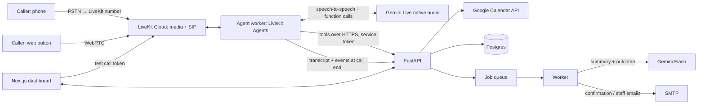

# SPEC – AI Voice Receptionist
**Repo:** `ai-voice-receptionist` · **Priority:** 1 · **Follows:** `docs/CONVENTIONS.md`

## 1. Goal
An AI receptionist for small service businesses. It answers calls, by phone or a "Talk to us" button on the website. It holds a natural conversation and handles interruptions, answers FAQs, books, reschedules and cancels appointments in Google Calendar, takes messages, and hands off to a human when the caller asks or the agent can't help. Every call is saved with a transcript and summary, and a confirmation email goes to the caller.

**One-line value statement:** "Never miss a call: an AI receptionist that answers, books appointments in your calendar and hands off to a human when needed."

**Demo business:** a fictional hair salon, "Luma Hair Studio", with services, prices, staff, opening hours and FAQs. It's not medical or legal, to avoid regulated advice.

## 2. Who it's for and the problem
Salons, clinics, repair shops, agencies and other appointment-based businesses that miss calls outside hours or while busy. Each missed call is a lost booking, and a human receptionist is expensive.

## 3. Scope
### In scope (MVP)
1. **Channels:**
   - **Web call:** a "Talk to receptionist" button in the dashboard and on a demo landing page, over WebRTC. This is the main demo channel because it's free and works from any country.
   - **Phone:** inbound calls to one US local number, the free LiveKit number.
2. **Conversation:**
   - Speech-to-speech with Gemini Live (native audio), so the caller hears a natural voice with low delay.
   - The caller can interrupt the agent mid-sentence (barge-in).
   - The agent greets the caller with the business name and a recording notice: "This call may be recorded and transcribed."
   - English first. The language is configurable.
3. **Tools the agent can call** (function calling; each tool validates its input and returns structured results):

   | Tool | What it does |
   |---|---|
   | `get_business_info` | Opening hours, address, services and prices, staff. Comes from the business config. |
   | `answer_faq` | Looks up FAQ entries from the business config. |
   | `check_availability` | Returns free slots for a service, date range and staff member, using Calendar free/busy, opening hours, service duration and buffers. |
   | `book_appointment` | Creates the booking and the calendar event. |
   | `reschedule_appointment` | Finds the caller's booking by phone or email plus date, then moves it. |
   | `cancel_appointment` | Finds the booking the same way, then cancels it. |
   | `take_message` | Name, callback number and message, stored and emailed to staff. |
   | `request_human` | Hands off to a person. In demo mode this means taking a message flagged urgent plus an email to staff. With `TRANSFER_ENABLED=true` (production) it's a SIP transfer to the configured staff number. |

4. **Booking safety rules:**
   - The agent never invents a time. It may only offer slots returned by `check_availability`.
   - Before booking, it reads back the service, date, time (in the business's time zone), name and contact, and gets a clear "yes".
   - Double-booking is prevented by re-checking free/busy inside the booking step and by a database uniqueness constraint on (staff, start time).
   - Bookings carry an idempotency key per call and slot, so retries never create two events.
   - Every time is stored in UTC and spoken in the business's time zone.
5. **After the call** (job queue):
   - A summary and outcome are generated with Gemini Flash in text mode. Outcomes: booked, rescheduled, cancelled, FAQ answered, message taken, handed to human, or abandoned.
   - The transcript is saved.
   - A confirmation email goes to the caller for booking changes, if they gave an email.
   - A notification email goes to staff for messages and handoffs.
6. **Dashboard (Next.js + shadcn/ui):**
   - **Calls:** a list with filters (outcome, date), and a detail page with transcript, summary, tool calls, duration and latency numbers.
   - **Appointments:** a list synced with Google Calendar.
   - **Messages / callbacks.**
   - **Settings:** business info, services (duration, price, buffer), staff, opening hours, FAQs, the agent's voice and greeting, the handoff number, and email settings.
   - A "Talk to receptionist" test button.
   - Roles: `admin` and `staff`, per CONVENTIONS section 10.
7. **Guardrails:**
   - Stays on topic for the business. Gives no medical, legal or financial advice.
   - Doesn't reveal other customers' bookings: lookups require the caller's phone or email to match the booking.
   - A per-call time limit (`MAX_CALL_MINUTES`, default 10).
   - Transcripts kept for a retention period (`TRANSCRIPT_RETENTION_DAYS`, default 30) and then purged.
   - Raw audio is not stored by default.
8. **Evaluation:**
   - **30 scripted scenarios run in text mode with an LLM judge:**
     - Book, reschedule, cancel.
     - FAQ answers.
     - Fully booked day.
     - Out-of-hours request.
     - Caller changes their mind.
     - Caller asks for a human.
     - Off-topic or abusive caller.
     - Ambiguous date ("next Friday").
     - Wrong caller trying to cancel someone else's booking.
   - **Plus 10 real voice test calls** for latency.

### Out of scope
- Outbound calling campaigns.
- SMS (costs money per message, so email is used instead). Note SMS as a production add-on.
- Multiple businesses in one deployment: single-tenant.
- Calendars other than Google. Note Outlook/Microsoft 365 as a next step.
- Payments and deposits.
- Storing call audio recordings. Can be enabled later with consent and retention rules.
- Phone numbers outside the US in the free demo. Production uses a SIP trunk in the client's country.

## 4. Stack (decided)
| Component | Choice | Why |
|---|---|---|
| Voice framework | **LiveKit Agents (Python, open source, Apache 2.0)** | Production-grade real-time voice: WebRTC and phone (SIP) in one framework, built-in interruption handling and turn detection. It can be self-hosted, so there's no platform lock-in. |
| Voice model | **Gemini Live, native-audio Flash model (free tier)**, through LiveKit's Google plugin; model set in `.env` | Speech-to-speech in one model, with natural voice, low delay and function calling. $0 in development. Production uses paid Gemini or Vertex AI. |
| Voice hosting | **LiveKit Cloud, Build plan (free)**: media, agent deployment, one free US number | $0 with no card. 1,000 agent minutes a month is plenty for development and the demo. The same code runs on a self-hosted LiveKit server. |
| Post-call text work | Gemini Flash (free tier) behind `app/llm.py` | Summaries and outcome labels, the same as the other projects. |
| Backend API | FastAPI + Pydantic | Business config, tool endpoints, call records and dashboard API. |
| Jobs | Postgres-backed job queue (CONVENTIONS section 10) | Summaries and emails are durable and retried. No Redis. |
| Database | PostgreSQL (Neon in the demo) | Calls, transcripts, bookings, messages, config, users, jobs. |
| Calendar | Google Calendar API (service account with the business calendar shared to it) | Free. It's the calendar small businesses actually use. |
| Email | SMTP (any provider; Gmail with an app password in the demo) | Free and provider-neutral. Production uses the client's transactional email service. |
| Dashboard | Next.js + TypeScript + shadcn/ui + Tailwind; LiveKit JS client for web calls | Same front-end stack as the other projects. |
| Auth / migrations / tests | Per CONVENTIONS section 10 (Argon2 sessions, Alembic, pytest + Playwright) | Production-ready baseline. |
| Live demo | **Vercel** (dashboard + landing page) + **Render** (FastAPI) + **Neon** (Postgres) + **LiveKit Cloud** (agent + media + number) | All free. The agent runs on LiveKit Cloud because it must always be reachable; Render's free plan sleeps. |
| Production profile | LiveKit Cloud paid plan (or self-hosted LiveKit) + Azure Container Apps (API + worker) + Azure Database for PostgreSQL Flexible Server + Key Vault + Application Insights, in Bicep under `deploy/azure/`; SIP trunk (Twilio or Telnyx) for local numbers; paid Gemini or Vertex AI | What a client would run. Validated in CI, not deployed. |
| Development MCP servers | `shadcn` in `.mcp.json`; `neon` only at the deploy step | Per CONVENTIONS section 3a. |

**Not used, on purpose:**
- Vapi or Retell: there's no ongoing free tier, and they add platform lock-in. The README notes the design ports easily if a client insists.
- Twilio for the demo: costs money.
- A separate speech-to-text and text-to-speech pipeline: the native-audio model does both. LiveKit lets us switch to one later if a client needs a specific voice vendor.
- RAG or a vector database: the FAQ list for a small business fits in the agent's instructions and a simple lookup. Project 2's retrieval can be added as a tool later for large knowledge bases.
- Redis, a queue broker, LangChain.

## 5. Architecture

- The agent calls the API's tool endpoints with a service token, and the API owns all business logic and data. The agent stays thin and replaceable.
- Web-call access tokens are minted by the API: short-lived and limited to one room.

## 6. Data model
- **BusinessConfig:** name, timezone, address, greeting, voice, language, handoff_number, email settings.
- **Service:** name, duration_min, price, buffer_min, active.
- **Staff:** name, calendar_id, services.
- **OpeningHours:** day, open, close. **Holiday:** date.
- **FAQ:** question, answer, active.
- **Call:** id, channel (`web | phone`), caller_number (masked in the UI), started_at, ended_at, duration_s, outcome, summary, latency stats (p50/p95 response delay), tokens or estimated cost, status.
- **TranscriptTurn:** call_id, speaker, text, ts.
- **ToolCall:** call_id, tool, args (with personal data redacted), result_status, latency_ms.
- **Appointment:** id, service_id, staff_id, start_utc, end_utc, customer_name, phone, email, status (`booked | rescheduled | cancelled`), calendar_event_id, idempotency_key, call_id. Unique on (staff_id, start_utc) where status is `booked`.
- **Message:** call_id, name, callback_number, text, urgent, handled.
- **User, Job:** per CONVENTIONS section 10.

## 7. Key rules
- **Slots** = opening hours − holidays − Calendar busy times − buffers, sized to the service duration, from the next available slot up to `BOOKING_WINDOW_DAYS` (default 30).
- **Relative dates** ("tomorrow", "next Friday") are resolved in the business's time zone, and the agent confirms the exact date out loud.
- **Retrying tools:** if a tool call fails, the agent apologises, retries once, then offers to take a message. It never pretends a booking succeeded.
- **Demo mode:**
  - Calls are capped at 3 minutes.
  - A daily call cap (`DEMO_DAILY_CALLS`, default 20) protects the free tiers.
  - Bookings go to a demo calendar that's reset nightly by a job.
  - Real emails are sent only to addresses the caller gives. Staff emails go to the demo inbox.
- **Free-tier limits:** Gemini Live free-tier projects have a limit on concurrent sessions, and LiveKit's Build plan allows up to 5 concurrent agent sessions. The dashboard shows "Receptionist is busy, try again in a minute" when a call is refused.

## 8. Evaluation
- **Scenario tests (text mode):**
  - 30 scenarios in `eval/scenarios/*.yaml`, each with a caller persona, goal, expected tool calls and expected final state.
  - Run against the agent with an LLM judge (Gemini Flash), plus hard assertions on the database and calendar state.
  - **Metrics:**
    - Task success rate.
    - Correct-tool-call rate.
    - **Invented-slot rate:** times the agent offered a time that `check_availability` didn't return. Must be 0.
    - **Double bookings:** must be 0.
    - Handoff accuracy.
    - Guardrail pass rate.
- **Voice tests:**
  - 10 real web calls following a script.
  - Measured from LiveKit session metrics: response delay (end of caller speech → first agent audio) p50/p95, interruption handling (agent stops within 500 ms), call completion.
- **Cost:**
  - Tokens or minutes per call, with the estimated paid-tier cost per minute.
  - A production estimate for 500 and 2,000 calls a month in the README.
- **Free-tier handling:** the runner throttles, retries with backoff and caches judge calls.
- **Output:** `eval/results.md` and `eval/results.json`, committed.

## 9. Acceptance criteria
- [ ] `docker compose up` (API, worker, dashboard, Postgres) plus the agent running locally (`make agent-dev`, connected to LiveKit Cloud): a web call from the dashboard reaches the receptionist, which greets with the business name and the recording notice.
- [ ] A caller can book, reschedule and cancel by voice. The calendar event appears, moves or disappears, and the confirmation email arrives.
- [ ] The agent only offers real free slots, reads back details, and asks for confirmation before booking. Two simultaneous attempts at the same slot produce one booking (concurrency test).
- [ ] Interrupting the agent mid-sentence stops it, and it responds to the new input.
- [ ] "Can I talk to a person?" leads to an urgent message plus a staff email (demo), or a SIP transfer when `TRANSFER_ENABLED=true` (covered by an integration test using a mock).
- [ ] A wrong caller can't cancel or reveal someone else's appointment.
- [ ] Every call shows up in the dashboard with transcript, summary, outcome, tool calls and latency.
- [ ] Phone call to the free LiveKit US number works end to end, demonstrated in the video.
- [ ] `make eval` reproduces the README numbers, with 0 invented slots and 0 double bookings.
- [ ] Demo mode limits (call length, daily cap, nightly calendar reset) work.
- [ ] Production readiness (CONVENTIONS section 10) is met, including:
  - Durable post-call jobs.
  - Idempotent bookings and emails.
  - Short-lived, room-limited LiveKit tokens.
  - The agent-to-API service token.
  - Transcript retention purge.
  - A Playwright end-to-end test (log in → change settings → start a test web call with a simulated audio track or skip-audio flag → see the call record).
  - `deploy/azure/` Bicep validates in CI.
- [ ] `AGENTS.md` "Gotchas" lists:
  - Gemini Live free-tier concurrency and reliability.
  - LiveKit Build plan limits (5 concurrent sessions, cold starts).
  - Time zones (UTC storage, business time zone for speech).
  - The never-invent-slots rule.
  - Calendar sharing with the service account.
  - Demo calendar reset.
  - The agent being thin, with business logic in the API.
- [ ] Everything in CONVENTIONS section 8 is done, including the AI-tool handoff check in section 3a.

## 10. Environment variables
`LIVEKIT_URL`, `LIVEKIT_API_KEY`, `LIVEKIT_API_SECRET`, `GEMINI_API_KEY`, `VOICE_MODEL` (a Gemini Live native-audio model), `VOICE_NAME`, `LLM_MODEL` (a Gemini Flash model, for summaries), `DATABASE_URL`, `GOOGLE_SERVICE_ACCOUNT_JSON`, `GOOGLE_CALENDAR_ID`, `SMTP_HOST`, `SMTP_PORT`, `SMTP_USER`, `SMTP_PASSWORD`, `EMAIL_FROM`, `STAFF_NOTIFY_EMAIL`, `AGENT_SERVICE_TOKEN`, `TRANSFER_ENABLED=false`, `HANDOFF_NUMBER`, `MAX_CALL_MINUTES=10`, `BOOKING_WINDOW_DAYS=30`, `TRANSCRIPT_RETENTION_DAYS=30`, `DEMO_MODE`, `DEMO_DAILY_CALLS=20`, `SESSION_SECRET`, `WORKER_MODE=embedded|separate`, `ALLOWED_ORIGINS`, `NEXT_PUBLIC_API_URL`, `SENTRY_DSN` (optional).

## 11. Expected development cost
**$0.**
- LiveKit Cloud Build plan: 1,000 agent minutes a month, one free US number, no card.
- Gemini Live and Gemini Flash: free tier.
- Google Calendar API: free.
- SMTP via Gmail: free.
- Demo on the Vercel Hobby, Render free and Neon free plans.

**Notes:**
- The free US number's included inbound minutes are limited, so the web call is the main demo channel.
- Calling a US number from Pakistan is billed by *your* phone carrier, so test the phone path sparingly, or with a free calling app that reaches US numbers.

## 12. Upwork case study inputs
- **Problem:** missed calls mean lost bookings.
- **Solution:** a voice receptionist that books into Google Calendar and hands off to a human.
- **Stack:** LiveKit + Gemini Live, explained as no lock-in and self-hostable.
- **Result:** "Handles 30 test scenarios at X% success with 0 double bookings and 0 invented times; median response delay Y ms; estimated $Z per call in production."
