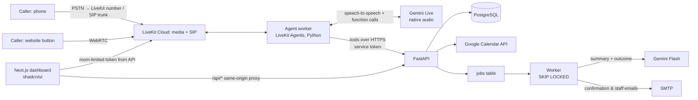

# Architecture

## Responsibilities

| Component | Owns | Never does |
|---|---|---|
| Agent (`agent/`) | Audio, turn-taking, barge-in (LiveKit), calling tools, transcript + latency report | Business rules, data access |
| API (`app/`) | Slots, bookings, guardrails, config, auth, call records, tokens | Audio |
| Worker (`app/jobs/`) | Summaries, emails, retention purge, nightly demo reset | Anything request-bound |
| Dashboard (`web/`) | UI for staff/admins, landing page, web-call page | Talks to the API only through `/api/*` |

## A call, step by step

1. **Web**: the dashboard asks `POST /api/web-call/token` → the API mints a 10-minute token for
   one new room with the agent dispatch attached. **Phone**: LiveKit's SIP inbound rule creates
   the room and dispatches the same agent.
2. The agent calls `POST /api/agent/calls/start`. The API checks demo caps and concurrency, creates
   the `calls` row, and returns the greeting, the instructions (built from the business config)
   and the call time limit.
3. Gemini Live talks to the caller. Each tool call goes to `POST /api/agent/tools/{tool}`,
   which validates input, enforces guardrails and records a redacted `tool_calls` row.
4. At hang-up the agent posts the transcript, per-turn latency and token usage to
   `/api/agent/calls/{id}/end`, which enqueues a `post_call` job in the same transaction.
5. The worker writes the summary and outcome, and emails the caller/staff through the
   idempotent outbox.

## Booking guarantees

- **No invented times**: `book_appointment` and `reschedule_appointment` accept only a `slot_id`
  that `check_availability` returned in the same call (checked against stored tool results).
- **Read-back**: booking requires `caller_confirmed=true`; reschedule/cancel return the matched
  booking for read-back first.
- **No double booking**: staff row lock (`SELECT … FOR UPDATE`) + exact re-check of bookings and
  calendar + partial unique index on `(staff_id, start_utc)` for active bookings.
- **Idempotency**: booking key = call + staff + start; Google event id derived from the key;
  emails keyed in `email_outbox`; jobs keyed in `jobs.idempotency_key`.
- **Privacy**: lookups need the caller's phone or email to match; tool args are redacted; logs
  carry ids and metadata only.

## Data retention

| Data | Retention | Purge |
|---|---|---|
| Transcript turns | `TRANSCRIPT_RETENTION_DAYS` (30) | Deleted by the daily `purge` job |
| Caller number, summary | 30 days | Blanked by `purge` (outcome and metrics kept) |
| Tool-call arguments | 30 days | Emptied by `purge` |
| Messages (handled) | 30 days | Name, number, text replaced |
| Email outbox | 30 days | Deleted |
| Appointments | 365 days after the appointment | Customer name, phone, email removed |
| Sessions, rate-limit counters, finished jobs | expiry / 2 days / 14 days | Deleted |
| Raw audio | Not stored (recording is off) | — |

## Backups and restore (production profile)

Azure Database for PostgreSQL Flexible Server keeps automated backups for 14 days
(`backupRetentionDays` in `deploy/azure/main.bicep`) with point-in-time restore to any second
in that window: `az postgres flexible-server restore --source-server <name> --restore-time
<UTC time> --name <new-server>`. Switch to geo-redundant backup for regional disaster recovery.
Blob storage has 7-day soft delete.

## Scaling

- API containers are stateless (sessions, rate limits and jobs live in Postgres): scale out on
  HTTP concurrency (1–5 replicas in the Bicep).
- Workers scale independently; `SKIP LOCKED` makes any number of workers safe.
- Voice capacity is bounded by LiveKit and Gemini concurrency: each agent replica handles
  several concurrent calls; scale agent replicas and the LiveKit/Gemini plan together.
